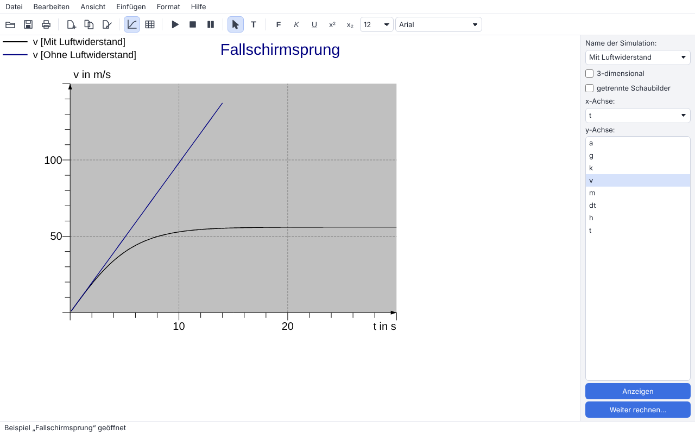

<!--claude-->
# Modellwerk

Modellbildung und Simulation für den Unterricht – als Mac-App und im Browser, auch auf dem iPad.

Modellwerk arbeitet wie das Schulprogramm Moebius: Man schreibt eine Programmschleife, gibt Startwerte an,
lässt sie *n*-mal wiederholen und sieht das Ergebnis als Schaubild und Tabelle. Dateien von Moebius (`.prg`)
lassen sich öffnen und wieder speichern.



## Im Browser und auf dem iPad

**https://alonearcticbear.github.io/Modellwerk/**

Auf dem iPad den Link in Safari öffnen und über *Teilen → Zum Home-Bildschirm* wie eine App ablegen.
*Datei → Speichern* legt eine Modellwerk-Datei (`.json`) ab, *Datei → Als Moebius-Datei exportieren* eine `.prg`-Datei.
Beides landet in der Dateien-App unter *Downloads*.

## Auf dem Mac

Voraussetzung: macOS und Python 3.9 oder neuer (zum Beispiel `brew install python`).

1. Dieses Repo herunterladen (*Code → Download ZIP*) und entpacken – oder
   `git clone https://github.com/AloneArcticBear/Modellwerk.git`
2. Im Terminal:

   ```
   cd Modellwerk/mac
   bash installieren_claude.command
   ```

   Das Skript baut `Modellwerk.app` und legt sie in den Programme-Ordner. Beim ersten Mal dauert das
   einige Minuten und braucht Internet (es lädt Qt/PySide6 und PyInstaller).

Ohne Installation starten: `bash start_claude.command [datei.prg]`

## Bedienung in Kürze

1. **Einfügen → Neue Simulation**: Programm, Startwerte und Einheiten eingeben – oder das Modell über
   *Sprachliches Modell* bzw. *Grafisches Modell* (Flussdiagramm) erzeugen lassen.
2. Rechts die Größe für die **x-Achse** wählen, Größen für die **y-Achse** markieren, **Anzeigen**.
   Die Achsen werden mit Größe und Einheit beschriftet, zum Beispiel *t in s*.
3. **Doppelklick** (iPad: Doppeltipp) auf Kurve, Achse oder Schaubild öffnet die Einstellungen,
   Rechtsklick (iPad: lange drücken) das Kontextmenü.
4. **Ansicht → Darstellung**: *Klassisch* sieht aus wie das Original, damit man im Unterricht mitkommt;
   *Modern* ist die aufgeräumte Variante.

## Funktionen

- `.prg` öffnen und speichern, inklusive Arbeitsblatt (Schaubild, Achsen, Kurven, Texte, Legende, Bilder)
- mehrere Simulationen pro Datei, bis zu 100 000 Wiederholungen (das Original schafft 8191)
- algorithmische, sprachliche und grafische Modellierung, Makros
- Schaubild: Linien, Punkte, Balken, Splines, 3D, getrennte Schaubilder, Hilfslinien, Legende,
  Achsenbeschriftung mit Einheiten
- Animation, Tabelle, Weiter rechnen, Texte und Grafiken auf dem Blatt
- Rückgängig, Kopieren und Einfügen, Drucken, Export als CSV und PNG

## Aufbau

| Ordner | Inhalt |
|---|---|
| `mac/` | Mac-App (Python und PySide6): `mw_core.py` Dateiformat und Rechenkern, `mw_app.py` Hauptfenster, `mw_dialogs.py`, `mw_draw.py`, `mw_icons.py`, Beispielmodelle |
| `web/` | Web-App (JavaScript ohne weitere Abhängigkeiten): Quelltext in `src/`, Bauskript `build.js` |
| `docs/` | fertige Webseite für GitHub Pages, erzeugt mit `node web/build.js` |

Nach Änderungen an der Web-App: `node web/build.js` (Node.js 18 oder neuer). Das schreibt `docs/index.html`
und zusätzlich eine Fassung für claude.ai nach `web/dist/`.

## Hinweise

- Modellwerk ist ein unabhängiges Projekt und nicht mit Moebius oder dessen Autor verbunden. Es enthält keinen
  Code, keine Grafiken und keine Dateien des Originals; Symbole, Hilfetexte und Beispiele sind eigene.
  Moebius-Dateien werden gelesen und geschrieben, damit man Modelle mit Moebius-Nutzern austauschen kann.
- Unverändert gespeicherte `.prg`-Dateien sind bytegleich mit dem Original. Nicht geprüft ist, ob das Original
  Dateien fehlerfrei öffnet, die Modellwerk neu erzeugt oder verändert hat.
- `.prg`-Dateien kennen weder Einheiten noch Textformatierung. Vollständig bleibt alles nur im eigenen
  Format `.json` erhalten.
- Erstellt mit [Claude](https://claude.ai) von Anthropic. Dateien mit `_claude` im Namen bzw. `#claude` oder
  `//claude` in der ersten Zeile stammen von Claude.

## Lizenz

Copyright (C) 2026 AloneArcticBear

Modellwerk ist freie Software: Du kannst es unter den Bedingungen der GNU General Public License, Version 3,
weitergeben und verändern. Es wird ohne jede Gewährleistung bereitgestellt. Den vollständigen Lizenztext
enthält [LICENSE](LICENSE).
